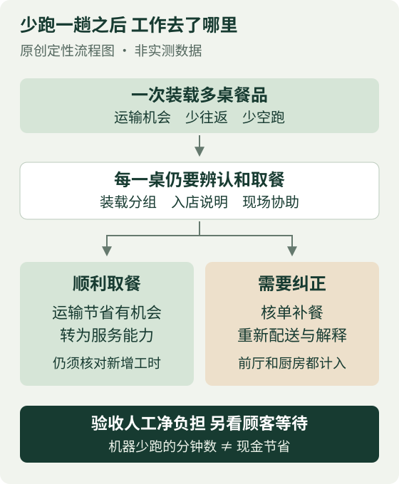
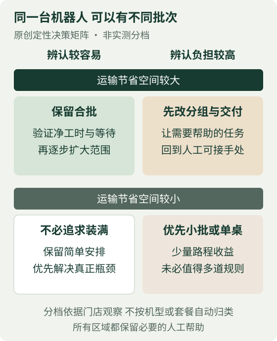

# 送餐机器人一次跑多桌 省下的路程会不会变成补餐工时

餐饮商业研究院 · 老板读本 · 2026年11月9日

如果门店已经在用送餐机器人，我不建议一出现取餐争议就全面取消多桌合批，但也不建议继续只按少跑了多少趟验收。值得保留的，是运输节省确实大于辨认、补餐和解释负担的那部分任务；不同价位、外观相似的餐品混在同一趟，又让顾客自行取餐时，应先收窄合批范围，再验证是否值得恢复。

这里的“合批”，指机器人一次装载多桌餐品，依次停靠配送。老板要决定的是哪些订单可以一起送，不是机器还要不要用。把所有任务都改为单桌，可能丢掉本来有用的运力；把所有任务都装满，则可能把分辨责任交给第一次见到这套设备的顾客。

## 案例里的补救保留了运输 却加回了说明

日本自助涮锅连锁しゃぶ葉按套餐价位提供不同菜品，机器人可一次给多桌运餐，由顾客取餐。2026年10月2日，运营方すかいらーく向J-CAST说明，使用入店引导机后，取餐指引未充分传达；将保留多桌配送，改由员工在入店或落座时解释，并加插图及多语指引。[1]

错层取餐的语音提醒，当时仅在部分门店验证，全店推广仍是计划；“顾客评价高”属于企业说法。10月5日朝日电视台采访同样记录了继续合批、人工说明和逐步增加提示的安排。[1][2]

两篇采访使补救方向更清楚，却不是两份独立经营成效验证。报道中的顾客投诉不能替代原订单、完整配送记录或损失账，也不足以判定具体顾客的动机。本文因此不计算错取发生率，不把套餐差价当损失，更不把新增提示写成已经证明有效的AI成果。

这次调整值得研究之处，在于两种自动化之间出现了依赖：前端少了一次人工接待，后端却仍要求顾客理解多桌取餐规则。它不证明引导机必然造成差错，但提示老板，不能分别验收每台设备都“能运行”，却不检查两台设备之间原来由谁解释。

## 合批节省的是运输 不保证整段服务更省事

一趟服务多桌，可能减少往返和装载后的空跑；但最后一桌也可能多等几次停靠，前面的顾客则要从一车餐品中认出自己的份额。路线相同、餐品容易区分时，这种交换可能划算。餐盘相似、份数接近，或者某桌本就需要额外协助时，新增判断可能抵消运输节省。这是机制分析，不是该连锁已经测出的效果。

辨认困难还可能把成本推迟到后面。少一盘餐，顾客未必立即找员工，也可能先等、再点一次；店员接到反馈时，再核单、补做、重新配送并解释。一次异常会同时占用前厅和厨房，而且常发生在本来就忙的餐段。机器少跑了一趟，不能直接抵扣这些人的分钟数。

图1提醒的是计账边界。应把减少的人工运输时间，与新增说明、装载分组、现场协助、补餐及沟通工时放在一起看；机器人运行时间另记，不能混成一个“节时率”。即使人工净工时下降，若没有减少加班、外包或排班支出，也不能直接说省下了工资。它仍可能释放桌边服务能力，但要看释放的时间有没有出现在需要它的时段。

## 先让餐品容易区分 再决定一趟装多少桌

我会先按取餐难度分任务，而不是先设一个统一的最大装载量。餐品身份清楚、桌号和所在层对应直接、少量说明即可理解的订单，可以保留合批。外观近似而套餐权益不同的餐品，更值得考虑分批、单桌配送，或在合适的交付点由员工协助；这些都是备选安排，需要核对现有设备能否支持。

套餐差异重要，不在于可以拿价差估算损失，而在于顾客对“我付的钱买到了什么”更敏感。一次难以解释的缺餐，可能使后续沟通变得复杂。相反，同套餐也不等于可以随意互换餐盘：数量、口味和等待顺序仍可能不同。分组的目标是降低实际辨认负担，不是用一个套餐标签代替核对。

说明也应靠近动作发生的地方。落座时讲过一次，不等于餐到时还能记住；屏幕、餐层与餐盘信息若彼此不一致，多加一句语音也未必有用。试点可以先让第一次使用的顾客辨认，观察需要员工补充什么，而不是只让熟练店员演示。不能仅靠颜色区分，也应给不方便看屏幕、听提示或自行取餐的人保留人工帮助。

图2中的建议会随条件反转。若运输距离短，原有人工本就顺路服务，多桌合批的收益可能很小，不值得为装满而增加规则。若路线长、送餐频繁，且取餐清楚，保留合批并把说明做扎实更合理。若路程收益大但辨认困难，应先改分组或交付方式；不能因为已经买了机器，就默认每种订单都必须由它混装。

## 用同类餐段比较 不用投诉条数代替发生率

真正的验收应比较“合批加必要说明”与“单桌或较小批次”，不能让一组有人指导，另一组完全没人管。门店可在相近客流和菜单条件下分时段观察，覆盖高峰与低峰，并记录每趟服务桌数、餐份数、停靠等待，以及额外人工分钟。不同班次、熟客比例和促销变化都可能影响结果，应与结果一起保留。

异常记录要有分母。顾客询问、拿错后现场纠正、餐品缺失后补送，可以分别按配送桌次或餐份统计，不应混成一个含义不明的投诉率。抽查部分没有投诉的配送，也有助于发现顾客自行重下单、员工顺手补救而没有正式记录的情况。记录只需匿名任务编号、餐品和处理过程，不必收集顾客影像或身份资料。

总量之外，还要看最容易被平均数掩盖的任务：后续停靠桌等得更久没有，复杂订单是否集中需要帮助，忙时补餐有没有挤占正常出菜。净人工分钟下降，但某类顾客的等待持续恶化，也不能直接扩大。观察期太短、异常很少时，应保留“不足以判断”，不要用零投诉证明零问题。

若准备采购附加提醒功能，应问清兼容机型、适用场景、费用、维护和失效时的人工接手方式。语音提醒只说明系统发出了提示，不证明顾客理解，也不证明餐品已恢复正确归属。厂商未披露检测机制时，不应替它补出视觉识别、传感器或模型架构。

## 老板可以先批这三项调整

**先确定可以合批的任务。** 让店长划出容易区分与需要协助的餐品组合，保留人工帮助；若混装仍反复引起辨认困难，就缩小批次或改单桌，而不是要求员工不断解释同一问题。

**把试点验收改成全段服务账。** 同时观察运输、说明、补餐和沟通，单列最后几桌的等待。只有人工负担确实下降、取餐与等待没有持续恶化，才逐步扩大；证据不足就维持有限范围。

**附加功能只批有退出条件的试用。** 先确认现有分组与指引是否足够，再比较新提醒带来的改善与费用、培训和维护负担。若主要效果只是增加提示声，而解释和返工没有减少，就不追加投入。机器人可以继续跑，合批范围却不必越大越好。

## 来源与研究范围

[1] J-CASTニュース，2026年10月2日，关于しゃぶ葉多桌配送与取餐指引的采访。[原文](https://www.j-cast.com/2026/10/02518266.html?p=all)。企业措施与推广状态采用采访当时口径，不作为当前全店覆盖证明。

[2] 朝日电视台，2026年10月5日，关于顾客反映及运营方应对的采访。[原文](https://news.tv-asahi.co.jp/news_society/articles/900201165.html)。用于核对补救方向；企业回应与[1]同源，不构成独立效果评估。

截至2026年11月9日核读。未取得门店原订单、损失账、对照试验、完整成本与当前全店配置，未开展现场测量或新增Pro咨询。分组方式、比较方案和两幅图均为独立分析或建议，不是案例实测结论；两篇报道的历史复发时间叙述不一致，本文不采用该时间线。
