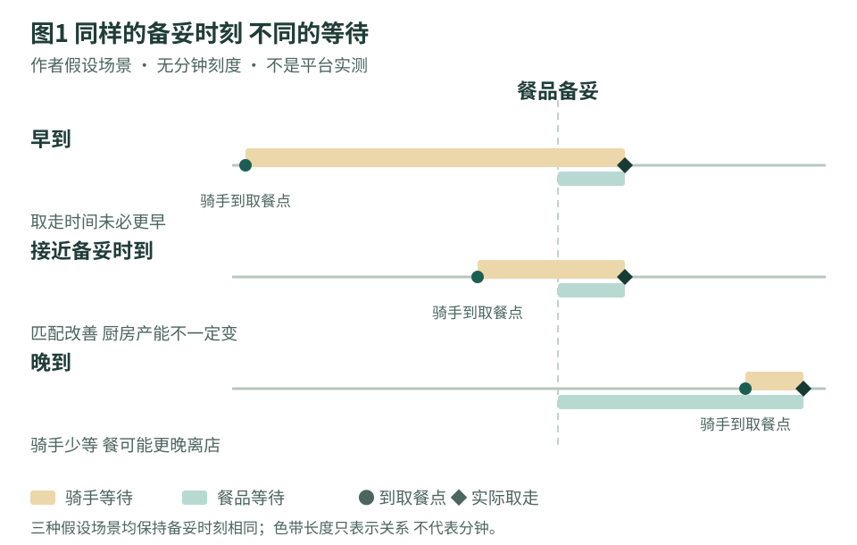
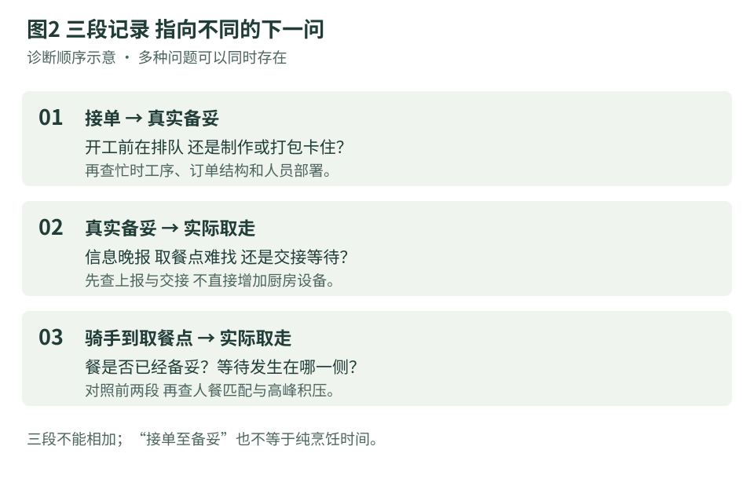

# 骑手等餐少了 后厨就真的更快了吗

餐饮商业研究院 · 老板读本 · 2026年11月9日

外卖高峰时，门口不再挤满等餐骑手，当然是好事。但如果老板正据此决定减少后厨人手，或为“AI出餐提速”追加预算，还需要再看一组记录：整单何时真正备妥，骑手何时到达可交接的位置，又何时取走。

**对餐已经做好却取不走、或骑手过早到店的门店，应先检查信息和交接；只有确认积压主要发生在备妥之前，而且现有工序、排班或设备形成约束，才进一步讨论厨房投入。** 等餐减少可以来自双方更合拍，也可以来自到店更晚，单看一个数字无法决定该买什么。

## 已上线的AI 先看它测量了哪一段

饿了么与高校团队的MobiCom 2025论文报告，骑手活动识别已在中国多城市部署，利用手机传感器辅助识别运动状态。其ETS指标是从骑手下车到再次上车的停留时长预测，报告的总体平均绝对误差减少1.8秒。**这个数字是预测更准，不是实际等餐、配送或后厨制作缩短1.8秒。** 数据与部署均属作者报告，不能当成本项目独立验证。[论文原文，§3、§4.3](https://arxiv.org/html/2509.24303v1)

停留时间的含义决定了这项证据能支持什么。骑手可能在楼内步行、寻找取餐点，或等待交接；这些环节即使得到更好的估计，也没有直接告诉老板一道菜炒了多久。把平台预测指标放进厨房效率报表，会让两种不同的改进看起来像同一件事。

另一个已经公开的机制更贴近商家动作。美团在2025年8月的算法说明中介绍，商家可通过“出餐宝”上报出餐，出餐完毕后再调度骑手。页面没有给出这项安排的全国覆盖率、单店适用资格或厨房产能变化。它与前述饿了么论文属于不同平台和项目，不能拼成同一套系统的投入产出链。[美团官方说明](https://www.meituan.com/news/NN250825125002496)

两份材料放在一起，说明了一个值得门店核查的经营问题：预测改善与调度改变，都可能影响取餐环节的表现；要决定厨房预算，仍须知道餐本身在什么时刻具备交付条件。这是本文的分析判断，不是两家平台共同验证的结论。

## 到店晚一点 门口变安静了 餐未必更早离店

设想同一份订单，备妥时间没有改变。原来骑手早到，在门店等待；后来骑手接近备妥时到达，取走时间也不变。骑手等待减少了，门店少了催问和拥挤，却没有新增厨房产能。这种匹配改善仍可能有价值，尤其当催问反复打断配餐时；只是不能据此给厨房记一笔提速，也不能直接核减人手。

再换一个条件：骑手比备妥时刻晚到，餐在取餐区放得更久。骑手看到的等待可以很短，订单离店反而更晚。本文没有认定某个平台实际造成了这种情况，这只是说明为什么验收要同时看餐和人的等待。菜品质量、交付时限与顾客体验有各自约束，不应为了让一种等待好看而容忍另一种等待持续增长。

图1把老板容易忽略的交换摆出来：在备妥时间相同的情况下，到店时间改变就可能改变等餐指标。把骑手合理安排到店，与让厨房更早完成，是两项可以同时推进、也应分别验收的工作。

## 先统一真实备妥 再解释三段记录

“备妥”最好按整单能够交接来记录。主菜出锅但饮料还没有装好，或餐已打包却找不到对应订单，都不能仅凭一次按钮操作证明整单已经可取。系统上报时间可以单独保存，用来检查信息是否及时；不应一开始就把它当成实际备妥时间。

门店可以先抽样记录接单、真实备妥、骑手到达取餐点和实际取走四个节点。骑手骑车抵达商圈，与已经走到取餐点也不同；定义应保持一致，不必收集完整轨迹或身份信息。匿名订单编号与现场时间记录足以开始排查。

据此看三段时长：接单至备妥，反映门店内等待、制作和打包的合计；备妥至取走，反映餐品交接前停留；骑手到达取餐点至取走，反映骑手在该交接环节的等待。骑手等待可能与备妥前流程、备妥后停留分别重叠，**三段不能相加成总耗时，也不能把第一段全部叫作烹饪时间。**

如果接单至备妥经常拖长，下一步要分清是开工前排队、某道菜卡住，还是打包等待。如果餐已备妥却久未取走，先检查上报是否及时、取餐点是否易找及是否发生交接等待。如果骑手已到但餐未好，再检查到店与备妥的匹配和忙时积压。多种问题可能同时发生，图2只是安排观察顺序，不能替代现场判断。

## 别把一次上报变成员工追逐的成绩

若考核只奖励更早点击“已出餐”，系统记录可能先变漂亮，而真实交接没有变化。相反，餐早已备好、员工忙得没上报，也会让调度获得的信息滞后。这是两种待检查的流程风险，不是对具名平台或商户行为的指控。

因此，试用新终端或自动上报功能时，应同时核对它在什么事件后触发、是否对应整单、异常由谁处理。餐品返工、缺项、订单取消和重复扫描发生时，记录是否仍能解释实际过程，也应在获授权的测试范围内检查。不要把提前上报当作减少骑手等待的办法，更不要为了试验制造真实虚假订单。

如果现有后台已经能可靠上报，而员工只是不知道由谁操作，先改岗位交接可能比买新硬件更合适。如果上报动作确实打断高峰工作，自动化才值得比较。比较范围应包含安装、接口、维护、培训、人工核对与故障时的接手，不能仅凭设备免费就认定实施没有成本。

省下催问与找单时间，可能改善工作秩序，但只有加班、外包或排班支出实际可避免时，才能进一步算现金节省。单店无完整成本和对照数据时，不宜用平台指标推算门店投资回收期。

## 用同类餐段决定下一笔钱花在哪里

验收可以先覆盖相似订单结构的忙时和闲时，保留未完成、取消、返工与异常交接记录，而非只抽取顺利取走的订单。菜单、订单量、班次和配送供给变化都可能改变等待，前后对比时应一起说明。少数特别慢的订单也值得单列，不能只让均值代表高峰承受能力。

第一项决定，是把真实备妥与系统上报分开观察。若两者经常错位，先修正触发和交接；没有可靠节点，不急着给AI或员工分配功劳与责任。

第二项决定，是同时保护人和餐的等待。骑手等待下降、餐品停留未持续恶化，且交接准确性、顾客体验与完整成本符合预设验收要求时，才考虑扩大信息或调度配合。若只是把等待移给餐品，应先调整流程，并核对顾客实际体验。

第三项决定，才是追加厨房投入。只有积压确实集中在备妥前，进一步工序观察又支持排班、设备或制作顺序存在瓶颈，才做有限试验。观察改善是否出现在真正繁忙的时段，并核对完整费用；证据不够，就保留原有能力，不用一项更好看的等待指标替代采购判断。

## 研究说明

截至2026年11月9日核读。本文是基于公开原始材料的经营诊断研究，不是产品评测或门店效果实测。论文的上线月份在不同章节存在冲突，本文不采用单一上线月份，也不把写作时部署范围当作2026年现况。论文另一项定价试验不用于推算餐厅收益。

未取得门店原始订单、完整成本、当期商家功能资格或同批对照，未新增Pro咨询、商户登录、外部联络、真实调度操作或门店实验。两幅图与试用建议均为作者分析。正文不提供食品保存时长、安全放行标准或减员保证。来源口径、未采用材料及去重记录见随文来源台账。
