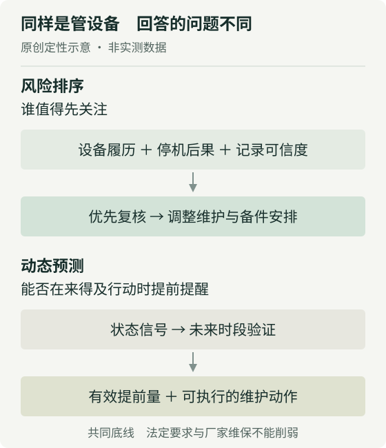
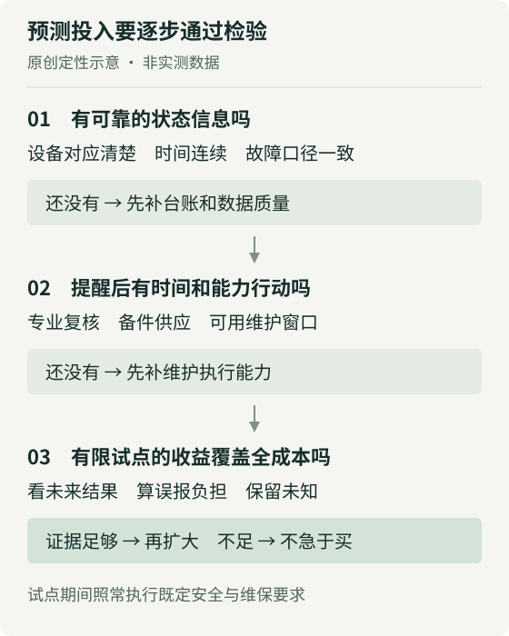

# 设备风险分了四档之后 餐厅还需要故障预测吗

餐饮设备管理研究 · 2026年11月9日

一家餐厅准备花钱升级设备管理，先买预测故障的系统，还是先补台账、给设备排出维保优先级？如果连哪台设备反复出问题、停机后有没有替代、上次保养做了什么都说不清，我建议先投后者。它未必能告诉你设备哪天坏，却能让本周有限的检查时间、备件和停机窗口用在更值得关注的地方。

这个判断有条件。如果关键设备已有可靠的连续监测，同类故障反复发生，而且提前发现后确实来得及处理，预测系统就可能值得试。决定顺序的不是门店有没有“AI”，而是下一笔钱能否改变维护安排，以及这种改变有没有证据支持。

## 大兴机场案例证明到哪一步

首都机场集团披露，大兴机场餐饮商圈自2026年7月起将1400余台设备分四档管理，通过赋权、综合评分与聚类实现分级；历史故障率权重为61.65%。报道所称“100%”，是与历史台账比对的高风险识别，8月文章写9台，10月文章未给台数。它不是1400余台设备未来故障的预测准确率；61.65%也仅是该评分体系的权重，不是故障成因的贡献率或预测解释率。[1][2]

公开材料未提供前瞻时间切分、误报漏报及原始数据，因而还不能据此判断未来预测效果，也不能据此断言发生了数据泄漏。材料中的“4小时到2分钟”指资料整理或统计任务；视觉评判、大模型诊断和物联网实时预测则是后续规划。[1][2]

这两篇报道来自同一机构、讲同一案例，不能当成两次独立验证。上述事实能支持“设备分级与资料整理已经落地”，支持不了“已经准确预测故障”或“整体维修成本大幅下降”。至于这一套做法能给普通餐厅省多少钱，公开资料没有给出可直接采用的答案。

## 排出先后顺序和预测未来是两种能力

设备分档回答的首先是“谁值得优先关注”。把过去经常故障、缺少替代能力、停机后影响大的设备放在前面，店长便有依据安排复核和维护。这样的排序即使完全不预测具体故障日期，也可能有用：维护资源不足时，平均分配检查时间并不一定是好办法。

但历史风险高，不等于下周就会坏。过去维修很多，也可能是旧问题已经解决；从未报修，也可能是使用时间短或记录缺失。一个分数即便与历史故障高度一致，仍需另做检验，才知道它能否在新的一段时间里提前识别问题。把设备分为四组，也不会自动得到“四组各有多大故障概率”。

预测性维护要求多走一步：用设备状态的变化判断未来风险，并让提醒早于可采取行动的最后时点。美国国家标准与技术研究院的相关说明，将依据温度、噪声、振动等状态信息预判故障的做法，与按周期安排的预防性维护区分开来。[3] 这里借用的是定义，不把美国制造业的成本或收益数字搬进餐厅。

**图1说明的是两种决策链，而非两种算法的成绩比较。** 风险排序可以支持周期性计划，动态预测则还要证明预警时间足够、信号可信、有人能够响应。二者可以配合，不必把“上预测系统”当成分级管理的必然终点。

## 先把分级变成一张真正能执行的排程

对记录不完整的餐厅，我更愿意先做一张能追溯的设备表。设备身份、位置和型号要稳定，维修事件要区分故障、例行保养与操作问题，时间要区分报障、到场、恢复使用。否则，同一台设备改过名字、同一次报修被记了两遍，都会把排序带偏。数据不齐时，应标记“待核实”，不能把空白当作零故障。

分级时还应把“可能出问题”和“出问题的后果”分开。举个假设：两台冷藏设备历史报修次数相同，一台有合适的备用容量，另一台承担无法及时转移的食材。即使故障概率相同，后者也可能更值得优先复核。反过来，一台报修频繁但影响很小的设备，不应仅凭次数挤占关键设备的维护窗口。这是经营上的取舍，不是该机场案例已经测出的结论。

下一步才是排程。让设备负责人和合资格维保人员确认：哪些需要加做状态复核，哪些要准备备件，哪些适合在低峰完成既定保养，哪些应进入更换评估。低风险标签不能成为减少法定检查、延后厂家要求保养或突破安全要求的理由；这些底线先满足，再讨论额外资源怎么分。

这也解释了为什么一套易懂的规则可能比复杂模型更值得先做。员工知道什么情况需要补照片、什么时候上报、由谁确认，记录才会持续。后台可以用脚本整理资料、检查缺项，或用模型辅助归类，但设备状态和安全结论仍需人工确认。把记录做快，是节省管理工作；能不能因此减少故障，还要看之后的结果。

## 什么时候我会改为支持预测试点

我会在三个条件同时成立时改变建议。首先，损失集中在少数关键设备和明确的故障类型上，而不是到处零散报修。其次，在故障发生前确有稳定、可采集的状态变化，监测数据能对应到同一台设备和正确时间。最后，收到提醒后有可执行的动作，例如安排专业复核、调配备用能力或预留合适维护窗口。

缺少最后一条，预测再早也可能只是多一条通知。若零件采购和服务安排需要的时间远长于信号能提供的提前量，就要先解决备件与服务能力；若员工频繁收到无效提醒，还会增加复核负担。相反，设备关键、故障后果大且能及时干预时，哪怕只选一种设备做有限试点，也比全店装满传感器更容易判断投入是否值得。

采购时也不必要求供应商预测精确到某一天。更实际的问题是：能否针对事先约定的故障类型，在门店来得及处理的窗口内提出有效提醒？若只能在故障已经出现时识别异常，它仍可能帮助发现问题，但不宜按“提前避免停机”的收益来定价。

## 让试点对未来负责 再算完整成本

试点开始前，先选清楚设备和故障类型，并保留现有的合规维保作为底线。用截至某个日期以前的资料制定规则，冻结版本，再观察之后的记录。不能看到结果后不断调规则，却仍把同一段记录称为独立验证。如果供应商说模型会持续更新，也要保留每次提醒当时的版本与输入，避免事后解释替代当时表现。

比较对象也要合理。新系统应与“已经把台账和常规维保做好”的方案比，而不只是与无人认真记录的旧状态比。可以先保留原有维护安排，记录预测提醒，由合资格人员按现行流程评估，不自动执行维修或停机。对明显安全异常仍应立即依规定处置，不能为了试验而延误。

每条提醒至少留住时间、对象、建议动作、复核结果与处置记录；同时记录没有提醒却发生的故障。需要看的不只是命中了几次，还包括无效复核占了多少时间、漏掉了什么、有效提醒提前了多久，以及这些时间能否真正用来安排维护。发生干预后设备没有坏，不能直接算“误报”；也不能直接算“成功避免故障”，因为缺少不干预时的结果，应单独记录。

如果观察期里只有很少几次相关故障，就应把“不足以判断”写进结论。店数多不等于同类故障样本多，短期没有停机也不等于系统有效。更强的比较需要兼顾同类设备、负荷、季节及维保执行差异，必要时延长观察或分阶段实施，而不是用一个漂亮的百分比结束验收。

完整成本同样不能只看软件报价。硬件安装与校准、网络、订阅、数据整理、员工培训、提醒复核、维保服务、误报造成的不必要停机，以及后续设备换型时的适配，都应进入预算。还要事先确认数据能否导出，退出后是否仍保留设备履历。整理任务节省的分钟数，只有确实减少加班、外包支出，或让同样人员完成更多必要工作时，才转成相应的经营价值；不能直接乘工资就宣称现金节省。

我的评估顺序是先看能确认的停机与损失变化，再扣除新增系统和运维成本；对“避免了多少次尚未发生的故障”，保留不确定性。安全与合规要求不参与这种成本交换。

## 老板现在可以作出的三个决定

**第一，先批基础管理，不先批全店预测。** 指定一名设备记录负责人，先把关键设备的身份、历史事件和既定维保要求核清，再与专业维保方把风险排序转成下一个维护周期的安排。目标是清楚谁先查、为什么先查、查完如何更新，不是赶着给所有设备贴四种颜色。

**第二，把预测预算改成有边界的试点预算。** 只有状态信息可靠、提前提醒后能够行动的设备才进入试点，采购前约定故障口径、提前量要求、对照方案、完整成本上限及退出方式。不能拿历史比对的成绩代替未来验收。

**第三，预先写下扩大或停止的理由。** 若有效提醒能改善排程，且收益覆盖持续成本，再考虑扩展；若主要新增的是误报复核，或数据仍不可靠，就停在台账与分级管理，把精力用于记录和维护执行。设备管理可以不升级为预测项目，但不能停在一张没人执行的风险排名表上。

## 来源与证据范围

[1] 首都机场集团公开案例，2026年8月11日。[原文](https://www.cah.com.cn/content/2026/08-11/7492751009286983680.html)。机构自报，非独立成效评估。

[2] 首都机场集团同一案例后续报道，2026年10月29日。[原文](https://www.cah.com.cn/content/2026/10-29/7521393079782215680.html)。与[1]合并视为一个案例来源，不据两次报道扩大证据强度。

[3] NIST，Manufacturing Machinery Maintenance。[原文](https://www.nist.gov/el/applied-economics-office/manufacturing/topics-manufacturing/manufacturing-machinery-maintenance)。本文仅用于维护方式的定义参照。

文中门店举例、投入顺序、试点设计及两张图为独立分析或建议，不是案例实测结果。事实核对截至2026年11月9日。
